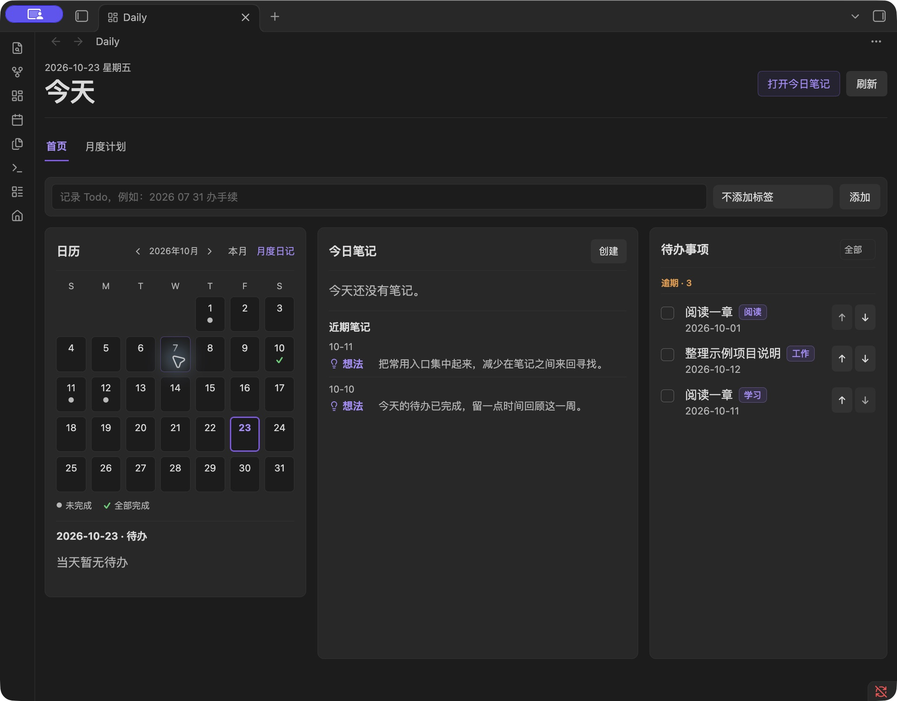
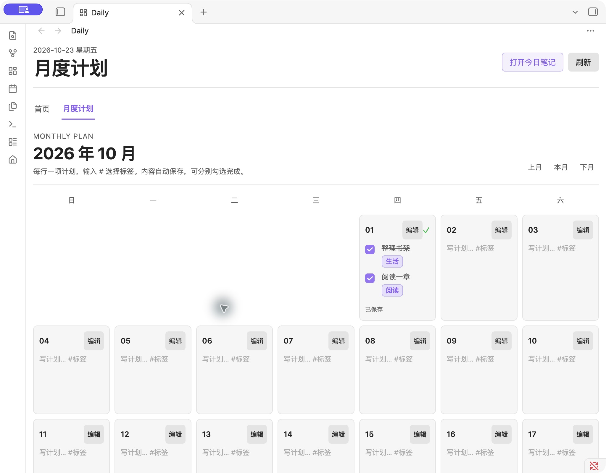

<div align="center">

# Daily

你的每日笔记与待办首页。

[](#系统要求)
[](src/main.ts)
[](LICENSE)

[安装运行](#安装运行) · [使用指南](docs/USAGE.md) · [更新记录](CHANGELOG.md) · [问题反馈](https://github.com/HappyChenchen/obsidian-dashboard/issues)

</div>

打开 Obsidian，先看一眼今天要做什么，再开始记录。Daily 将日记、待办、日历和月度计划放在同一个首页，适合已经用 Markdown 记录生活，希望少切换几个页面的人。

插件在本地运行，没有后端、账号或遥测，不发送网络请求。笔记仍然是你自己的 Markdown 文件。

**当前是 0.1.0 试用阶段，尚无公开 Release，也未上架社区插件目录。** 仓库已附带安装包，无需编译即可手动安装，界面目前为中文。仓库名为 `obsidian-dashboard`，插件显示名称为 **Daily**。

## 界面预览

首页默认显示日历、今日笔记和待办。



月度计划每行一项，文字后直接写标签。



截图来自 macOS / Obsidian 1.14.5，内容均为虚构示例。

## 它能做什么

- 打开或创建今日笔记，查看最近记录的想法。
- 汇总 Markdown 待办，按日期分组、按自由标签筛选，勾选时写回原笔记。
- 用日历查看每天的任务：浅灰点表示还有未完成项，绿勾表示全部完成。
- 编写月度计划，每行独立完成；输入 `#` 推荐标签，停止输入后自动保存。
- 通过「月度日记」回顾整月的 Todo 和想法，也能向指定日期的日记添加 Todo。
- 自定义日记目录、待办来源、完成项显示、首页布局和每周起始日。
- 按需开启资料库和学习打卡，自行配置课程。
- 导出、恢复插件数据，自动保存历史副本；检测外部变化并提示冲突。

## 安装运行

Daily 安装在某一个 Obsidian 笔记库中，每个库分别启用。

### 直接下载安装包（推荐）

**[下载 Daily 0.1.0 安装包](https://github.com/HappyChenchen/obsidian-dashboard/raw/refs/heads/main/downloads/daily-0.1.0.zip)** · [查看安装说明](docs/INSTALL.md) · [SHA-256 校验文件](downloads/SHA256SUMS.txt)

不需要 Git、Node.js 或编程经验。下载后按下方「安装到笔记库」操作即可。如果已经下载整个仓库，安装包就在 `downloads/daily-0.1.0.zip`；请解压这个文件，不要把源码目录当成插件安装。

### 安装到笔记库

1. 解压 `daily-0.1.0.zip`，得到 `dashboard-home` 文件夹。
2. 关闭目标笔记库窗口，将文件夹放进该库的 `.obsidian/plugins/`。
3. 重新打开 Obsidian，进入 **设置 → 第三方插件**，启用 **Daily**。
4. 点击左侧房子图标，或在命令面板运行 `Daily: Open home`。

正确目录应为：

```text
你的笔记库/.obsidian/plugins/dashboard-home/
├── main.js
├── manifest.json
└── styles.css
```

不要再嵌套一层目录。macOS 按 `Command + Shift + .` 显示隐藏文件。安装已经构建好的文件不需要 Node.js。开发者也可以运行：

```sh
npm run install:local -- "/你的测试笔记库完整路径"
```

安装目录保留 `dashboard-home`，以兼容旧版本。升级前导出备份，仅替换上面三个文件，**保留 `data.json` 和 `backups/`**。完整步骤见 [安装指南](docs/INSTALL.md)。

### 从源码构建

准备 Node.js 22 或以上版本，推荐 24，然后运行：

```sh
git clone https://github.com/HappyChenchen/obsidian-dashboard.git
cd obsidian-dashboard
npm ci
npm run package
```

构建结果：

```text
dist/
├── daily-0.1.0.zip        # 可直接解压安装
├── dashboard-home/       # 三个插件文件
├── INSTALL.md            # 安装说明
└── SHA256SUMS.txt         # 文件校验和
```

## 开始使用

1. 首次打开点击「设置日记位置」，可读取 Obsidian 核心日记设置，预览路径后确认。
2. 在首页输入 `买牛奶 #生活` 添加 Todo；也可以输入 `2026 10 25 出游 #出行` 指定日期。
3. 在「月度计划」中编辑某天，每行写一项，如 `阅读一章 #阅读`；输入 `#` 会出现建议，也可以直接写新标签。
4. 点击日历日期查看任务，或打开「月度日记」回顾整月。

**月度计划和日记 Todo 如何联动？** 首页与日历统一展示两种事项。日记 Todo 保存在 Markdown，勾选后写回原文；月度计划保存在插件数据，不自动复制到日记。「月度日记」是汇总视图，点击日期打开日记，点击加号向对应日记添加 Todo；其摘要不是独立的任务编辑器。

详细操作见 [使用指南](docs/USAGE.md)，也可以先用 [虚构示例库](examples/README.md) 试用。

## 数据从哪里来

Daily 读取当前库中允许扫描的 Markdown 文件，按配置的路径识别日记，并从任务文本中解析标签和日期。可在设置中限定待办来源和排除目录。

| 内容 | 保存位置 |
| --- | --- |
| 日记、Markdown Todo、文章和读书笔记 | 笔记库中的 `.md` 文件 |
| 月度计划、完成状态、课程和打卡、界面设置 | `.obsidian/plugins/dashboard-home/data.json` |
| 自动历史副本 | `.obsidian/plugins/dashboard-home/backups/` |
| 手动导出的插件备份 | 笔记库中的 `Daily Backups/` |

自定义 Obsidian 配置目录时，上述 `.obsidian` 使用该库的实际配置目录。插件备份不包含 Markdown 和附件，请另外备份整个笔记库。「清除存档」只清空插件记录，保留笔记和设置，因此来自笔记的待办仍会显示。

外部设置变化会触发重新加载；不同日期的修改可合并，同一天的冲突会保留副本供选择。这不替代同步服务，真实双设备同时写入仍待验证，详见 [备份与同步](docs/USAGE.md#备份恢复与同步)。

## 项目结构

```text
.
├── src/                   # 首页、日历、任务、设置与数据处理
├── styles.css             # 界面样式
├── manifest.json          # Obsidian 插件信息
├── scripts/               # 构建检查、安装、打包和版本同步
├── downloads/             # 仓库内可直接安装的 ZIP 和校验文件
├── tests/                 # 模拟 Obsidian API 的回归测试
├── examples/vault/        # 虚构示例笔记
├── docs/                  # 使用、安装、发布和后续计划
└── .github/               # CI、草稿发布、Issue 与 PR 模板
```

`npm run dev` 监听构建，`npm run check` 执行元数据检查、测试和构建。贡献方式见 [CONTRIBUTING.md](CONTRIBUTING.md)，后续方向见 [路线图](docs/ROADMAP.md)，维护者流程见 [发布指南](docs/RELEASE.md)。插件通过 Obsidian 文件安装，不发布到 npm。

## 系统要求

- Obsidian 1.8.0 或以上；源码构建需要 Node.js 22+，安装包无需 Node.js。
- 已在 macOS / Obsidian 1.14.5 验证安装、标签、计划、窄分栏和备份恢复。
- Windows、Linux、移动设备、最低支持版本和真实双设备同步尚待实机验证。

## 常见问题

**插件列表里找不到 Daily？**

确认安装目录内直接包含三个文件，第三方插件已开启，再重新打开笔记库。目前无法从社区插件市场搜索安装。

**日记目录和我原来的不一样？**

打开「设置 → Daily → 日记 → 连接或调整日记」，读取核心日记配置或手动填写，确认预览路径。不会移动已有笔记。

**首页没有任务？**

在笔记中写入 `- [ ] 阅读一章 #阅读`，检查待办来源范围和标签筛选，再点击「刷新」。代码块、属性和注释中的示例任务不会进入列表。

**标签需要预先设置吗？**

不需要。常用标签只是输入推荐，实际写下的标签均可筛选；一条任务可以带多个标签。

**能和 Tasks 等插件一起用吗？**

可以读取常规 Markdown 复选框，但不保证循环任务、自定义状态和其他插件的全部语法兼容。首次使用请在副本中验证你的任务写法。

**卸载会丢失内容吗？**

Markdown 笔记仍在。月度计划和打卡保存在插件目录中，卸载前请先导出插件备份并复制到独立位置。

## 隐私

插件仅在本地读取、更新笔记和插件数据，没有遥测、账号和远程服务。Obsidian Sync 等工具由用户自行管理。反馈问题请使用虚构或脱敏示例，不要上传完整笔记库和真实 `data.json`。详情见 [SECURITY.md](SECURITY.md)。

## 许可证

[MIT](LICENSE)。

## 说明

Daily 是独立社区项目，与 Obsidian 官方没有隶属关系。文档结构参考 [codex-meter](https://github.com/HappyChenchen/codex-meter)，代码与安装方式针对 Obsidian 插件设计。
