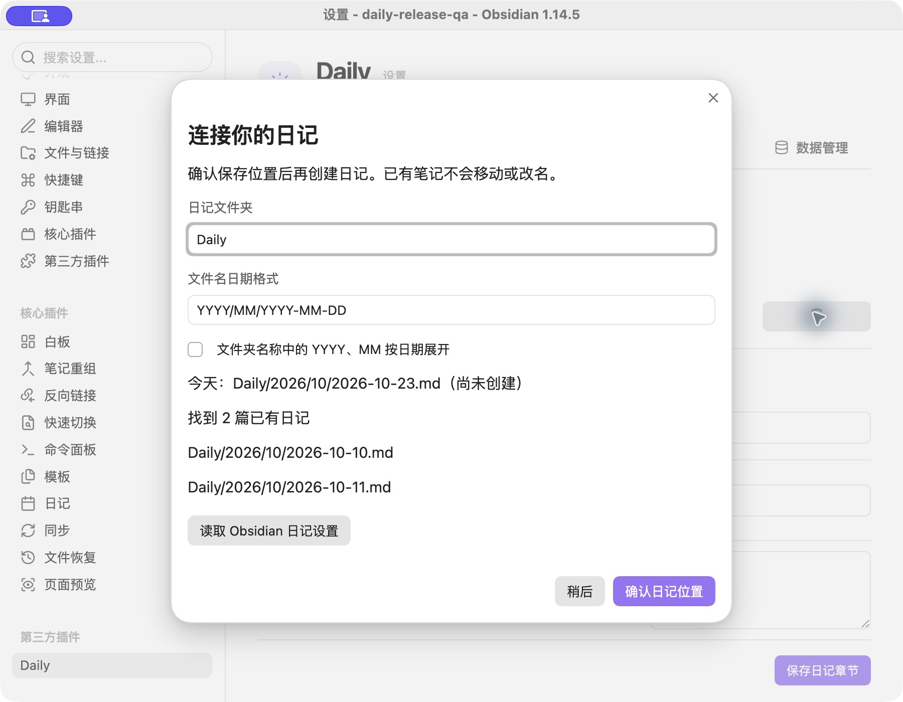
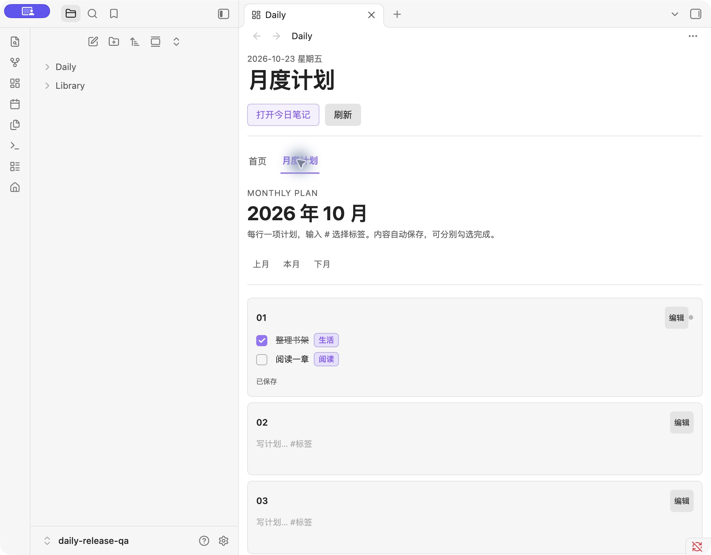
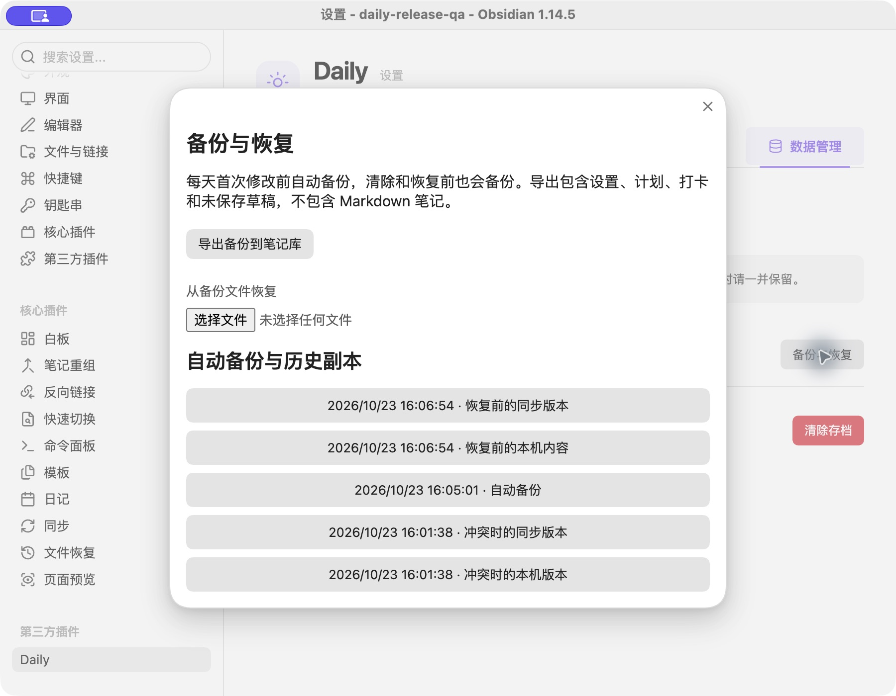

# Daily 使用指南

[返回 README](../README.md) · [安装步骤](INSTALL.md)

## 第一次使用与日记位置

首页点击「设置日记位置」，或到「设置 → Daily → 日记 → 连接或调整日记」。可以读取 Obsidian 核心日记配置，也可以手动填写目录和日期格式。窗口会显示今天的完整路径、已找到的日记数量和示例文件；确认后才允许插件创建日记，不会移动或改写已有日记。

默认目录为 `Daily/YYYY/MM`，文件名格式为 `YYYY-MM-DD`。如果沿用核心日记配置，目录按字面使用，文件名日期格式也支持 `YYYY/MM/YYYY-MM-DD` 这样的子目录写法。只有启用“文件夹名称中的 YYYY、MM 按日期展开”时，目录中的日期片段才会展开。



首页「打开今日笔记」会打开或创建当天日记；新增待办写入配置的二级标题，默认是 `## 今日todo`。新模板仅包含待办和想法。修改章节名称不会批量重命名旧笔记标题。跨日或唤醒后更新当天入口，保留正在浏览的历史日期。

仓库还提供 [日记、读书和文章模板](../templates/README.md)，以及 [可下载的示例库](../examples/README.md)。自定义模板由核心「日记／模板」插件应用；Daily 的日记位置导入不导入模板文件，Daily 自己新建笔记时仍使用内置格式。

## 自由标签与待办

正文末尾填写标签即可，例如：

```md
- [ ] 安排周末出游 #出行 #生活 📅 2026-10-25
- [ ] 阅读一章 #阅读
```

首页和月度日记的筛选菜单收集当前范围内实际使用的全部标签。一条待办有多个标签时，在任意一个标签下都能找到；没有标签的事项出现在“无标签”中。标签不需要提前登记。

设置中的“待办标签”是输入推荐列表，默认生活、工作、学习、其他，可增删、排序、清空。默认标签只在新增待办没有手写标签时追加；删除推荐不会删除笔记中的标签，也不会让它失去筛选资格。标签支持中文、字母、数字、下划线、短横线和斜杠，不能包含空格或全为数字。

在「设置 → Daily → 待办」选择全部笔记、仅日记或指定文件夹，并可排除目录。路径为库内相对路径，每行一个，包含子文件夹，排除优先。插件内的月度计划始终参与统计。新任务仍写入对应日记，若被来源规则排除，会提示调整来源。

- 复选框任务可以位于任意笔记；Daily 的待办章节也兼容普通文字行。
- 首页输入 `2026 10 25 安排出游 #出行`，转换成带日期的任务。
- 任务按逾期、今天、以后、未设日期分组。组内可拖动，或使用 ↑ / ↓ 按钮排序。
- “已完成待办”可选隐藏、折叠或全部显示；日历仍显示完整明细，可以取消完成。
- 无效日期保留原文，放入“日期待修正”，不加入日历。
- 代码块、frontmatter 和独立 HTML 注释块中的伪任务被忽略。
- 不同位置的同名任务保留。原笔记发生变化时，只更新能唯一定位的任务；无法确认时提示刷新。

目前支持常规 Markdown 复选框和文档中的日期写法，不保证 Tasks 等插件的循环任务、自定义状态、所有元数据语法均兼容。笔记重命名、插行或修改任务文字后，手动排序可能重置。

## 月度日记与任务联动

首页日历中的「月度日记」按月汇总日记、Todo 和计划。点击某天打开或创建日记，点击加号向该日期的日记添加 Todo。月度日记中的 Todo 是摘要展示；要勾选完成，可使用首页待办、日历详情或原笔记中的复选框。

| 事项 | 保存位置 | 操作结果 |
| --- | --- | --- |
| 日记和其他笔记的 Todo | 原 Markdown 笔记 | 首页或日历勾选后写回原文 |
| 月度计划 | 插件数据 | 各界面同步完成状态，不自动复制到日记 |

这两种事项统一进入首页和日历，但分别保存。月度日记的摘要会反映原事项的更新。

## 月度计划

**每行一项计划，各自勾选完成。** 点击日期格子的“编辑”或正文后输入：

```text
整理书架 #生活
阅读一章 #阅读
```

正文后显示标签。输入 `#` 弹出常用标签及其他月度计划中使用过的标签，继续输入可筛选；↑ / ↓ 选择，Enter 插入，Esc 关闭。Shift + Enter 换行；没有候选时 Enter 也可换行。每一行可重复使用其他行的标签，同一行不重复推荐已有标签。


停止输入片刻后自动保存，显示保存状态。失败时保留本次运行中的草稿，可重试或从“备份与恢复”导出包含草稿的副本。未保存成功的草稿不保证在应用强制退出后保留。

移动未改动的行、增加其他行，会保留原事项的完成状态。修改某一行文字或标签，会把该行视为新事项，其他行不受影响。重复文字的两行仍是不同事项。

旧版计划按非空行迁移，原来的整天完成状态继承到各行，旧分类转换成标签。继续保留原有插件 ID 和可读的计划正文。升级前应导出备份；降级旧版可能无法识别逐项完成状态。

首页日历与月度计划共享月份和日期。点击首页的计划正文可定位到对应日期。月度计划与 Markdown 待办相互独立，不会互相复制或修改。

## 日历与窄分栏

- 只显示当月日期，月初空格用于星期对齐。
- 浅灰点表示还有未完成项，绿勾表示全部完成；无任务则没有标记。
- 有待办不会把日期背景染成紫色。选中日期保留边框。
- 首页日历统计该日的笔记待办和计划事项；月度计划的标记只统计计划事项。
- 星期起始日可选周日或周一，所有日历共用。

窄分栏中，月度计划自动变为按日期排列的列表。点击“编辑”展开输入区，避免在很窄的七列格子里输入；宽度恢复后仍显示月历。面板可拖动标题调整顺序，待办可用 ↑ / ↓ 调整顺序。



## 设置入口

「设置 → Daily」分为首页、日记、待办、日历和数据管理。切换分组保留未提交的设置输入；关闭设置前应点击相应保存按钮。开关和每周起始日即时保存。

| 配置 | 默认值 | 用途 |
| --- | --- | --- |
| 首页标题 | 今天 | 自定义首页名称 |
| 最近记录数量 | 3 条 | 可关闭或显示 3 / 5 / 10 条 |
| 日记章节 | 今日todo、想法/思考 | 新模板和首页摘要 |
| 待办来源 | 全部笔记 | 限定收集范围、排除目录 |
| 已完成待办 | 隐藏 | 可折叠或全部显示 |
| 每周起始日 | 周日 | 可改为周一 |
| 常用标签 | 生活、工作、学习、其他 | 输入推荐，不限制自由标签 |

资料库和学习打卡默认关闭。资料库按目录或 `type: article` / `type: book` 识别。学习课程每行填写 `分组 | 课程名称`；调整顺序保留打卡身份，移除课程仍保留历史打卡。

## 备份、恢复与同步

「设置 → Daily → 数据管理 → 备份与恢复」提供：

- **导出备份到笔记库**：生成 `Daily Backups/` 下的 JSON 文件，包含计划、逐项完成、打卡、设置及未保存草稿。可复制到独立备份位置。
- **从备份文件恢复**：选择 Daily 备份，先查看计划天数、事项和打卡数量，再确认替换。无效格式和不支持的版本会拒绝导入。
- **历史副本**：每天首次写入已有数据前自动备份；清除、恢复和同步冲突时另存副本。恢复前也备份当前内容。

自动备份位于笔记库配置目录的 `plugins/dashboard-home/backups/`。目前不自动删除历史副本，可按需要在文件管理器中整理。此备份与原数据在同一笔记库，不能替代独立备份；Markdown 笔记和附件需要另外备份。

外部修改 `data.json` 后会重新加载。不同日期的计划、不同配置项，以及不同日期/课程的打卡可合并；同一天的计划在两边都变化时，不会静默覆盖，而是保留本机和同步版本。到备份管理中选择继续使用本机内容和草稿，或使用同步版本。也可以先导出两份版本后手工整理。

这是检测外部变化与三方合并，不是分布式事务：两个设备在同一时刻写入、同步服务延迟或覆盖仍可能形成竞争。真实双设备同步尚未验证。更稳妥的方式是等同步完成后再切换设备，保留独立备份。



## 清除存档

“清除存档”清空计划、完成状态、打卡和待办排序，保留笔记、附件、课程和设置。确认后先备份，再清除；备份失败会中止清除。可通过历史副本恢复。来自 Markdown 笔记的待办仍会显示。

## 验证范围

已在 macOS / Obsidian 1.14.5 的独立虚构库检查全新安装、日记配置读取、逐项完成、标签筛选、窄分栏、备份导出和恢复。自动化测试使用模拟 Obsidian API。Windows/Linux 应用内交互、真实移动设备和双设备同步仍需实机验证；发布前检查见 [RELEASE.md](RELEASE.md)。
